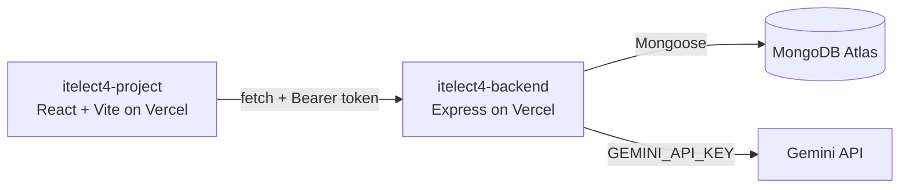

# Campus Lost & Found — Backend API (ITELECT4)

[](https://github.com/Magne1025/itelect4-backend/actions/workflows/ci.yml)

Secure REST API backend for the Campus Lost and Found System, powered by Node.js, Express, TypeScript, and MongoDB Atlas. Deployed as serverless functions on Vercel.

## Architecture




## 🚀 Live Deployments

- **Live Backend API (Vercel):** [https://itelect4-backend-amber.vercel.app](https://itelect4-backend-amber.vercel.app)
- **Live Frontend Web App (Vercel):** [https://itelect4-project-green.vercel.app](https://itelect4-project-green.vercel.app)
- **GitHub Repository (Backend):** [https://github.com/Magne1025/itelect4-backend](https://github.com/Magne1025/itelect4-backend)
- **GitHub Repository (Frontend):** [https://github.com/Magne1025/itelect4-project](https://github.com/Magne1025/itelect4-project)

---

## 🛠️ Tech Stack & Architecture

- **Runtime & Language:** Node.js (v20+), TypeScript (ESNext)
- **Framework:** Express.js
- **Database & ODM:** MongoDB Atlas, Mongoose
- **Security & Authentication:** JWT (`jsonwebtoken`), bcrypt password hashing, CORS whitelist protection
- **Deployment Platform:** Vercel Serverless Functions

---

## 📡 API Endpoints

| Method | Endpoint | Protection | Description |
|---|---|---|---|
| `GET` | `/api/health` | Public | Healthcheck endpoint (`{"ok": true, "db": true}`) |
| `GET` | `/api/categories` | Public | Returns all reference item categories |
| `GET` | `/api/categories/:code`| Public | Lookup single category by code |
| `POST` | `/api/auth/register` | Public | Registers a new campus user |
| `POST` | `/api/auth/login` | Public | Logs in a user & returns signed JWT token |
| `GET` | `/api/items` | Private (JWT) | List cataloged items (supports `?status=`, `?category=`, `?mine=true`) |
| `GET` | `/api/items/:id` | Private (JWT) | Retrieve item details by ID |
| `POST` | `/api/items` | Private (JWT) | Report a lost or found item |
| `PATCH`| `/api/items/:id` | Private (JWT) | Update status or details of reported item |
| `DELETE`| `/api/items/:id`| Private (JWT) | Delete an item report |
| `POST` | `/api/ai` | Private (JWT) | AI review & feedback via Google Gemini (`gemini-flash-latest`) |

---

## ⚙️ Environment Variables

Copy `.env.example` to `.env`:

```env
PORT=4000
MONGODB_URI=mongodb+srv://<username>:<password>@cluster0.0ysryas.mongodb.net/lostandfound?retryWrites=true&w=majority
JWT_SECRET=your_jwt_secret_key_here
CORS_ORIGIN=https://itelect4-project-green.vercel.app,http://localhost:5173
GEMINI_API_KEY=your_gemini_api_key_here
```

---

## 🏃 Local Development

Install dependencies:
```bash
npm install
```

Seed initial reference categories:
```bash
npm run seed
```

Start dev server:
```bash
npm run dev
```

Build and typecheck:
```bash
npm run build
```

Run test suite:
```bash
npm test
```

---

## 🤖 AI-Use Disclosure
AI coding assistants were utilized during the development of this project for pair programming, code scaffolding, automated testing setup (Vitest and Supertest), CI workflow configuration, and code quality type checking assistance. All generated code and tests have been reviewed, verified, and validated.
